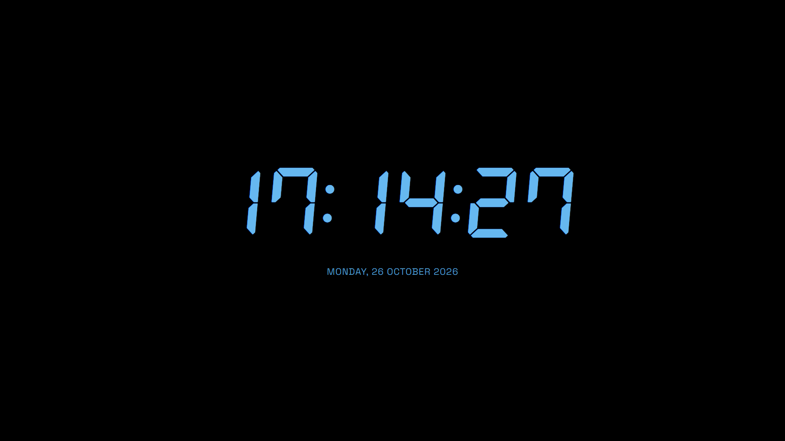
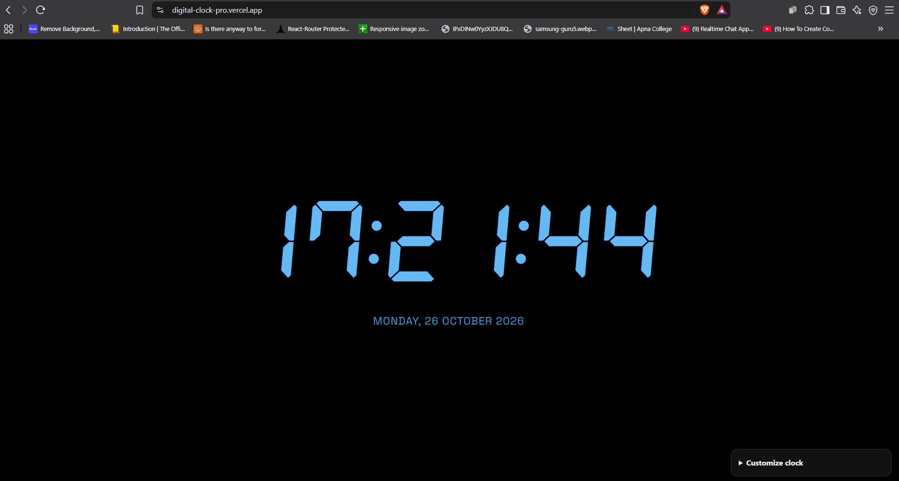
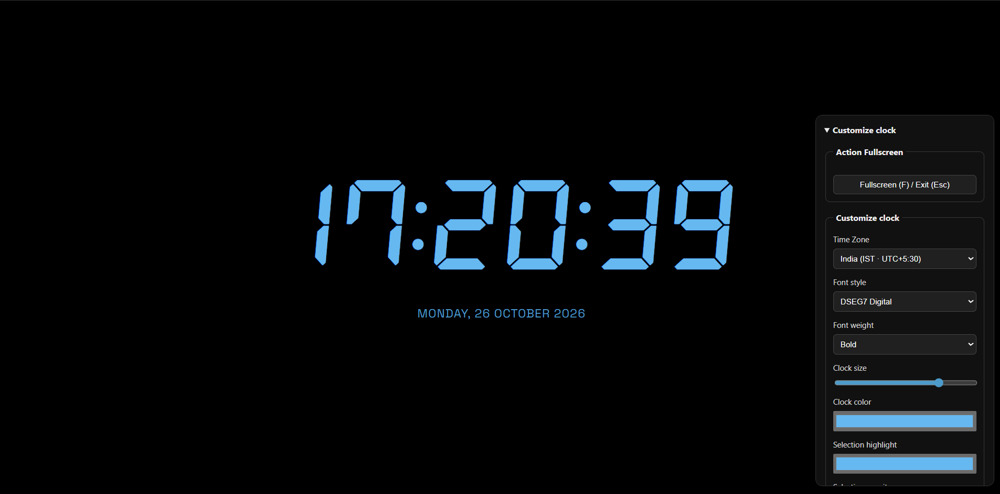

# Digital Clock 

> Pradeep Sharma - Designed & Developed Digital Clock

A modern, responsive digital clock with customizable typography, colors, time zones, and display settings. This project focuses on a clean interface, personalization, accessibility, and responsive design.

<p align="center">
  <a href="https://digital-clock-pro.vercel.app/">
    <strong>🚀 View Live Demo</strong>
  </a>
  &nbsp; · &nbsp;
  <a href="https://pradeep-sharma.vercel.app/">
    <strong>👨‍💻 Developer Portfolio</strong>
  </a>
</p>

## Overview

Digital Clock is a lightweight web application that displays the current time and date with a customizable interface. Users can personalize the clock's appearance, switch between time zones, choose a 12-hour or 24-hour format, and enter Fullscreen mode for a distraction-free experience.

The project is built with HTML, CSS, and vanilla JavaScript, with a focus on simplicity, usability, and performance.

## Features

- Real-Time Clock — Displays the current time and updates automatically.
- Time Zone Selection — Switch between local time, Indian Standard Time (IST), UTC, and supported international time zones.
- 12-Hour and 24-Hour Formats — Choose your preferred time display format.
- Customizable Typography — Select from digital, monospaced, modern, rounded, futuristic, serif, and system font styles.
- Font Customization — Adjust font size, weight, and italic styling.
- Custom Colors — Personalize the clock text, date text, and text-selection highlight colors.
- Date Display Controls — Show or hide the date and customize its font, size, weight, color, and letter spacing.
- Seconds Toggle — Display or hide seconds.
- Fullscreen Mode — Expand the clock to fill the screen.
- Keyboard Shortcuts — Toggle Fullscreen using the F key and exit using Esc.
- Reset Settings — Restore the default appearance and display preferences.
- Responsive Design — Adapts to desktop, tablet, and mobile screens.
- Accessibility — Includes semantic HTML, ARIA labels, and keyboard-friendly controls.
- SEO and Social Sharing — Includes metadata, canonical URLs, Open Graph tags, Twitter card metadata, and structured data.

## Live Demo
[Digital Clock](https://digital-clock-pro.vercel.app/) \
Link: https://digital-clock-pro.vercel.app/

Try customizing the clock's appearance, changing time zones, switching time formats, and using Fullscreen mode.


## Screenshots

### Clock Fullscreen


### Digital Clock Interface


### Clock Customization Settings



# Getting Started
### Prerequisites
You need a modern web browser, a code editor and if you want DSEG7 Font (File:- DSEG7Classic-BoldItalic.woff2). No package manager or build tools are required for the basic application.


### Installation
1. Clone the repository:

```bash
git clone <YOUR_REPOSITORY_URL>
```

2. Open index.html in your browser, or use a local development server such as the VS Code Live Server extension.


## Project Structure

```text
digital-clock/
├── DSEG7Classic-BoldItalic.woff2  # Font File, Web Open Font Format(woff2)
├── index.html    # Main clock interface and SEO metadata
├── styles.css    # Clock styling and responsive layouts
├── script.js     # Clock logic and customization controls
└── README.md     # Project documentation

```

This structure reflects the core application files. Update it if your repository includes additional assets or directories.

# Usage
1. Open the Digital Clock website.

2. Expand Customize Clock to access the available settings.
3. Choose a font style and adjust the clock's size, weight, and color.
4. Select a time zone, such as India (IST), UTC, or your local time.
5. Switch between 12-hour and 24-hour time formats.
6. Customize the date display and choose whether to show seconds.
7. Press F or use the fullscreen button for an immersive display.
8. Use Reset Settings to restore the default configuration.

### Keyboard Shortcuts
```text
- F	     #Toggle Fullscreen mode
- Esc    #Exit Fullscreen mode
```
The browser handles Esc natively when Fullscreen mode is active.

### SEO and Metadata
The application includes metadata intended to improve discoverability and link previews:

- Page title and meta description.
- Author and creator information.
- Canonical URL.
- Open Graph metadata for social sharing.
- X (Twitter) card metadata.
- Theme color and color-scheme declarations.
- JSON-LD structured data describing the application as a web application.

The canonical URL points to the deployed clock website, while author information links to the developer portfolio.

# Deployment
The application is deployed on Vercel.

To deploy your own copy:

- Push the project to a Git repository.
- Import the repository into Vercel.
- Configure the project as a static website if prompted.
- Deploy the project and verify the generated URL.
- Update the canonical URL and social-sharing metadata if you use a different domain.

No server-side runtime is required for the core clock functionality.

# Contributing
*Contributions, suggestions, and bug reports are welcome.*

1. Fork the repository.
2. Create a feature branch.
3. Implement and test your changes.
4. Submit a pull request describing the changes.

Please keep the interface responsive, maintain accessibility, and avoid introducing unnecessary dependencies.

# Author
**Pradeep Sharma**\
Full Stack Developer - (React/Next/Node.js)

[Portfolio](https://pradeep-sharma.vercel.app/)\
[Live Project](https://digital-clock-pro.vercel.app/)